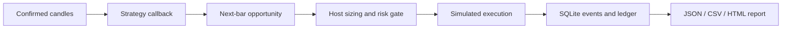

# ETH Trading Research Lab

**Offline trade simulation, risk controls and recoverable accounting in Python.**

[中文](README.zh-CN.md) · [Project overview](docs/PROJECT_OVERVIEW.md) · [Architecture](docs/ARCHITECTURE.md) · [Validation](docs/VALIDATION.md) · [Code license: MIT](LICENSE)

This project extracts reusable engineering components from a personal ETH trading project into a small, reproducible research framework. It follows a trade from a decision based on confirmed candles through position sizing, risk review, simulated execution and ledger recovery.

The synthetic demo uses a fictional `DEMO-USD-LINEAR` instrument. A separate [public ETH historical case](research/eth_case/README.md) evaluates the unchanged teaching rule on ETHUSDT spot data with explicit costs and chronological validation. Data download uses a public archive; backtests run offline, with no account access or live orders.

## The problem

A backtest can produce a plausible equity curve even when its mechanics are wrong: a signal may use information that was unavailable at decision time, contract units may be confused with notional exposure, or a fill may be counted twice after a restart.

This repository makes those mechanics inspectable. Its main question is: **can the path from a trading decision to its accounting outcome be reproduced and checked?** The historical case also reports economic results, including losses, without claiming a profitable strategy.

## Design and evidence

| Design choice | Why it matters | Evidence in the repository |
|---|---|---|
| Confirmed-candle decisions; next-bar pricing | Separates the information used for a decision from its execution price | [Replay tests](tests/test_confirmed_candle_replay.py) |
| Explicit contract, base, notional and margin units | Avoids double-counting leverage in PnL | [Sizing](src/quantlab/domain/sizing.py), [ledger tests](tests/test_ledger.py) |
| Risk approval before broker execution | A rejected request must not become a fill | [Workflow tests](tests/test_execution_brokers_and_workflow.py) |
| Event IDs and SQLite persistence | Supports duplicate detection and recovery from persisted facts | [Recovery tests](tests/test_sqlite_store.py) |
| Replaceable strategy callback; shared execution and ledger | Keeps teaching logic separate from accounting | [Teaching plugin](src/quantlab/tutorial.py), [host](src/quantlab/demo.py) |
| Fixed synthetic input and result hashes | Makes demonstrations reproducible without accounts or data services | [Verifier](scripts/verify.py), [reference JSON](sample_output/report.json) |



The demo is intentionally small: one instrument, long/flat decisions and one execution path. The [project overview](docs/PROJECT_OVERVIEW.md) explains the scope and tradeoffs.

## Reproduce the demonstration

Tested on **Python 3.13.7 / macOS**. Python 3.12 is the minimum target, but has not been separately tested. Only the Python standard library is required; no package installation or credentials are needed. After cloning, execution is offline.

```bash
git clone https://github.com/seanbc618-tech/eth-trading-research-lab.git
cd eth-trading-research-lab
PYTHONPATH=src python3 -m quantlab.demo
python3 scripts/verify.py
```

Open `outputs/demo/report.html` locally for the bilingual report. `report.json` contains fills, risk decisions, audit events and metrics; `equity.csv` contains marked equity. A [reference report](sample_output/report.html) is included; download it to view the HTML in a browser, or inspect the [reference JSON](sample_output/report.json) on GitHub.

To observe rejection before execution:

```bash
PYTHONPATH=src python3 -m quantlab.demo --risk-limit 100 --output outputs/rejected
```

Windows PowerShell: set `$env:PYTHONPATH="src"`, then use `python -m quantlab.demo` and `python scripts/verify.py`. The package name `quantlab` is retained as an internal import path.

## Verified behavior

| Check | Observed result |
|---|---|
| Selected existing regression suite | 43 tests passed |
| Default synthetic run | 96 hourly bars, 8 simulated fills |
| USD 100 order-limit scenario | 46 rejected entry requests, zero fills and zero PnL |
| Repeatability | Complete result matches the checked-in reference JSON |
| Temporal consistency | Truncated-run equity matches the full-run prefix; missing bars are rejected |
| Replaceability | No-trade and buy-once plugins run through the same host |
| Recovery | Existing tests recover orders, fills and ledger state after reopening SQLite |

See the [validation record](docs/VALIDATION.md) for commands, conditions and result identity. These are engineering checks on synthetic fixtures, not evidence of a profitable ETH strategy.

## Public ETH historical evidence

The [fixed-protocol case](research/eth_case/README.md) uses 2023 as its declared development interval and 2024 as its later evaluation. A verified source gap invalidates the entire 2023 segment; its metrics remain null. No replacement year or gap filling is used.

In 2024, the teaching strategy returns **−9.7548%** after the base assumptions of 10 bps fees and 5 bps adverse slippage per side, versus **+4.6098%** for a 10%-allocation buy-and-hold benchmark (marked equity). It also loses **1.7644%** at zero cost. The base risk gate later blocks new entries; cost scenarios therefore have different trade paths. These are full-account returns, not returns on allocated capital.

[All scenarios and quarterly results](research/eth_case/RESULTS.md) are published, including the invalid development runs. This is a retrospective chronological test without parameter optimization, not prospective validation or a completed fit-and-validate study.

```bash
python3 scripts/verify_empirical.py
PYTHONPATH=src python3 -m quantlab.empirical --fetch --check-reference
```

The downloader checks provider and pinned SHA-256 values. Later runs omit `--fetch` and replay cached data offline. Code remains MIT; [dataset-derived results have separate terms](research/eth_case/LICENSE.md).

## Strategy interface

A strategy implements `on_confirmed_candle(context)` and returns a `SignalProposal` or `None`. The example compares the latest close with a four-bar trailing mean and requests long or flat exposure. The host determines quantity and applies the risk gate; the strategy does not maintain a separate ledger.

[Replace the teaching strategy](docs/WALKTHROUGH.md) to inspect how this separation works. This is a Python protocol for trusted code, not a plugin sandbox or a complete strategy-registration platform.

## Model limitations

- The demo uses artificial prices, fixed fees and fixed adverse slippage, with full fills at the next bar's open. It does not model funding, liquidation, market impact or order-book liquidity.
- It supports one long/flat instrument. End-of-run positions are marked to market rather than forcibly closed. Final-bar signals without a following bar remain pending.
- The core includes separately tested funding and candle-based partial-fill primitives; the default demo does not exercise them.
- The historical case is a single-pair retrospective evaluation with an invalid development interval. It provides no prospective validation, investment-edge evidence or production-readiness claim.

## Code and documentation

| Path | Purpose |
|---|---|
| `src/quantlab/domain/` | Instrument units, order states, positions and ledger |
| `src/quantlab/market_data/` | Candles, event clock and strategy protocol |
| `src/quantlab/execution/` | Offline brokers and pre-execution risk workflow |
| `src/quantlab/persistence/`, `risk/` | SQLite recovery and central limits |
| `src/quantlab/tutorial.py`, `demo.py` | Teaching plugin and public demonstration |
| `examples/`, `sample_output/` | Generated fixture and reproducible reference output |
| `tests/`, `scripts/verify.py` | Regression and integration checks |

## Provenance and development

The generic core was selected from the owner's existing project. The public extraction, teaching integration and bilingual documentation were prepared with AI assistance. An [extraction manifest](docs/EXTRACTION_MANIFEST.json) records the copied files and transformations; a [publication audit](docs/PUBLICATION_AUDIT.md) describes the release boundary.

Private strategies, research parameters, real datasets, account records, deployment materials and original Git history are excluded. The public repository documents the implemented system and its checks; it does not establish who independently authored each original component.

Framework code is released under the [MIT License](LICENSE). The ETH case's dataset-derived reports and series are [CC BY-NC-SA 4.0](research/eth_case/LICENSE.md), subject to provider terms. See [NOTICE](NOTICE).
