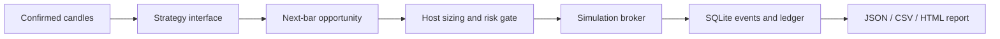

# Quant Replay Lab

**A small, auditable laboratory for event-driven financial engineering.**

[中文说明](README.zh-CN.md) · [Architecture](docs/ARCHITECTURE.md) · [Teaching walkthrough](docs/WALKTHROUGH.md) · [Validation](docs/VALIDATION.md)

Turn confirmed candles into strategy decisions, risk-reviewed orders, simulated fills, and a recoverable ledger. The project focuses on *whether an experiment is mechanically trustworthy* before asking whether a strategy is profitable.

## Try it in one minute

Python 3.12 or 3.13. Standard library only; no installation, API keys, downloads, or services.

```bash
git clone https://github.com/seanbc618-tech/quant-replay-lab.git
cd quant-replay-lab
PYTHONPATH=src python3 -m quantlab.demo
# A deliberately tight limit demonstrates risk rejection.
PYTHONPATH=src python3 -m quantlab.demo --risk-limit 100 --output outputs/rejected
# Run inherited unit tests and public-demo integration checks.
python3 scripts/verify.py
```

Open `outputs/demo/report.html` in your browser. The report is self-contained and bilingual. Machine-readable results are in `report.json`; the marked equity curve is in `equity.csv`. A reproducible reference run is included in [sample_output](sample_output/).

Windows PowerShell: set `$env:PYTHONPATH="src"`, then run the same `python -m quantlab.demo` commands without the shell prefix.

## What this demonstrates

| Engineering question | Implemented mechanism |
|---|---|
| Can a signal use information from a future candle? | The strategy callback receives only confirmed history; execution is priced at the following bar's open. |
| Can leverage accidentally multiply profit twice? | Explicit contract, base, notional and margin units; Decimal accounting. |
| Can an event be counted twice? | Idempotent fills and funding; conflicting event IDs are rejected. |
| Can an unapproved order become a fill? | A central risk decision precedes order creation and broker execution. |
| Can execution state survive restart? | SQLite persists orders, events and fills; recovery reconstructs the ledger. |
| Can someone reproduce the result? | Fixed synthetic data, deterministic event IDs, dataset and result SHA-256 receipts. |



## A replaceable strategy, a shared accounting path

The existing `ConfirmedCandleStrategy` protocol exposes one callback:

```python
def on_confirmed_candle(context: StrategyContext) -> SignalProposal | None:
    ...
```

The new teaching plugin compares the latest close with a four-bar trailing mean and requests long or flat exposure. The host owns quantity, execution and accounting. See [how to replace it](docs/WALKTHROUGH.md). This is an ordinary Python interface, **not a security sandbox** or the private platform's later plugin-registration system.

## Scope and interpretation

This release extracts generic primitives from an earlier local research core. It is **not a publication of private strategies or the complete later research platform**. Original strategy implementations, parameters, experiments, datasets, deployment code and repository history are excluded. [Provenance and publication boundary](docs/PROVENANCE.md) records exactly what was selected.

The 96 hourly candles are explicitly artificial and deterministic. Their returns are **not market evidence, out-of-sample evidence, or a profitability claim**. The demo supports one long/flat linear instrument, full next-open fills, fixed adverse slippage and fees. It does not model market impact, liquidation, or funding, and it has no exchange connector. Open positions, when present at the end, are marked rather than forcibly closed. Generic funding and partial-fill primitives are tested separately.

## Repository map

```text
src/quantlab/
  domain/          instrument units, sizing, order state, positions, ledger
  market_data/     candles, event time, confirmed-candle strategy interface
  execution/       offline replay / candle simulation and audited workflow
  persistence/     SQLite facts, recovery, reconciliation and safety state
  risk/            centralized order and portfolio limits
  tutorial.py      new teaching plugin
  demo.py          synthetic-data host and report generation
examples/          synthetic hourly CSV and its generator
sample_output/     checked reference report (synthetic only)
tests/             selected existing regression tests
scripts/verify.py  repeatability, risk, causality and isolation checks
```

## Authorship and release status

The extracted core comes from the owner's existing project. Public-only integration, teaching material and documentation were prepared with AI assistance; selected prior code retains its source hashes. This repository does not claim independent authorship of every line or validated investment performance. An application narrative should describe the owner's actual design, review and experimental contributions.

Released under the [MIT License](LICENSE). See [NOTICE](NOTICE) for provenance.

Public repository: [seanbc618-tech/quant-replay-lab](https://github.com/seanbc618-tech/quant-replay-lab).
