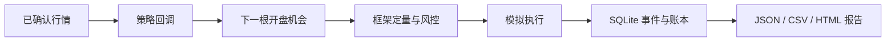

# ETH Trading Research Lab

**用 Python 实现的离线交易模拟、风险控制与可恢复账本。**

[English](README.md) · [项目介绍](docs/PROJECT_OVERVIEW.md) · [架构](docs/ARCHITECTURE.md) · [验证记录](docs/VALIDATION.md) · [MIT 许可证](LICENSE)

本项目从个人 ETH 交易项目中提取通用工程模块，构成一个小型、可复现的研究框架。它展示一笔交易如何从已确认行情上的决策，经过仓位计算和风险检查，进入模拟执行与账本恢复流程。

合成演示使用虚构的 `DEMO-USD-LINEAR` 品种。独立的[公开 ETH 历史案例](research/eth_case/README.md)用 ETHUSDT 现货行情检验同一教学规则，明确成本和时间切分。数据从公共归档下载，回测离线运行，不访问账户、不下实盘订单。

## 要解决的问题

回测即使画出看似合理的权益曲线，底层机制仍可能出错：决策使用了当时不可获得的信息、合约数量与名义价值被混淆，或者重启后同一笔成交被重复记账。

本仓库把这些环节展开为可检查的代码和测试，核心问题是：**从交易决策到会计结果的过程，能否被复现和核对？** 历史案例另行报告经济结果，包括亏损，不宣称发现盈利策略。

## 设计选择与证据

| 设计 | 解决的问题 | 可核验材料 |
|---|---|---|
| 已确认 K 线决策，下一根开盘定价 | 区分决策可用信息与执行价格 | [回放测试](tests/test_confirmed_candle_replay.py) |
| 明确合约、基础币、名义价值与保证金单位 | 防止杠杆重复乘入盈亏 | [定量代码](src/quantlab/domain/sizing.py)、[账本测试](tests/test_ledger.py) |
| 风控先于模拟执行 | 被拒绝的请求不能被记为成交 | [执行流程测试](tests/test_execution_brokers_and_workflow.py) |
| 事件 ID 与 SQLite 持久化 | 重复检测及基于已存事实恢复状态 | [恢复测试](tests/test_sqlite_store.py) |
| 可替换策略回调，共用执行及账本 | 分离教学规则与会计处理 | [教学策略](src/quantlab/tutorial.py)、[宿主](src/quantlab/demo.py) |
| 固定合成输入及结果哈希 | 无需账户或数据服务即可复现 | [验证脚本](scripts/verify.py)、[参考 JSON](sample_output/report.json) |



演示范围保持为单品种、做多/空仓和一条执行路径。设计取舍见[项目介绍](docs/PROJECT_OVERVIEW.md)。

## 复现演示

已在 **Python 3.13.7 / macOS** 验证。Python 3.12 是最低目标版本，未单独测试。仅使用标准库，无需安装依赖或配置凭据；克隆完成后可离线运行。

```bash
git clone https://github.com/seanbc618-tech/eth-trading-research-lab.git
cd eth-trading-research-lab
PYTHONPATH=src python3 -m quantlab.demo
python3 scripts/verify.py
```

在本地浏览器打开 `outputs/demo/report.html` 阅读双语报告。`report.json` 保存成交、风控决策、审计事件及指标；`equity.csv` 保存逐根估值。仓库提供[参考 HTML](sample_output/report.html)，下载后用浏览器查看，也可直接在 GitHub 查看[参考 JSON](sample_output/report.json)。

降低单笔限额，观察请求在执行前被拒绝：

```bash
PYTHONPATH=src python3 -m quantlab.demo --risk-limit 100 --output outputs/rejected
```

Windows PowerShell 先设置 `$env:PYTHONPATH="src"`，再运行 `python -m quantlab.demo` 和 `python scripts/verify.py`。内部 Python 导入名继续保留 `quantlab`。

## 已验证的行为

| 检查 | 结果 |
|---|---|
| 提取的已有回归套件 | 43 项测试通过 |
| 默认合成演示 | 96 根小时行情，8 笔模拟成交 |
| 单笔限额 100 美元 | 46 次入场请求被拒绝，零成交、零盈亏 |
| 可重复性 | 完整结果与仓库参考 JSON 一致 |
| 时序一致性 | 截断运行与完整运行的权益前缀一致；缺失行情被拒绝 |
| 可替换性 | 不交易和仅买入一次的插件通过同一宿主运行 |
| 恢复 | 已有测试验证重新打开 SQLite 后恢复订单、成交及账本 |

命令、条件与结果身份见[验证记录](docs/VALIDATION.md)。这些是合成 fixture 上的工程检查，不代表发现了盈利的 ETH 策略。

## 公开 ETH 实证

[固定方案](research/eth_case/README.md)声明 2023 为开发区间、2024 为后置评估。2023 因供应商真实数据缺口整体无效、指标留空，没有补行情或更换年份。

2024 年，在单边手续费 10 bps、滑点 5 bps 的基础假设下，教学策略按期末估值的账户收益为 **−9.7548%**，10% 初始仓位买入持有为 **+4.6098%**；教学策略零成本也亏损 **1.7644%**。基础场景后期触发回撤限额，阻止新增入场，因此各成本场景交易路径不同。收益以全部账户资金为分母，不是投入部分的收益。

[完整结果](research/eth_case/RESULTS.md)包含所有成本场景、季度表现和无效开发结果。这是未调参的回顾性时间后置检验，不是前瞻验证或完整的训练—验证成功案例。

```bash
python3 scripts/verify_empirical.py
PYTHONPATH=src python3 -m quantlab.empirical --fetch --check-reference
```

下载校验供应商及已固定的 SHA-256；后续省略 `--fetch` 即可离线复现。代码仍为 MIT，数据衍生结果遵循[单独许可](research/eth_case/LICENSE.md)。

## 策略接口

策略实现 `on_confirmed_candle(context)`，返回 `SignalProposal` 或 `None`。教学插件比较最新收盘价与四根均价，提出做多或空仓请求；数量与风控由宿主处理，策略不维护另一套账本。

可按[教学说明](docs/WALKTHROUGH.md)替换插件，验证模块边界。本版是针对可信代码的 Python 协议接口，不是插件安全沙箱或完整策略注册平台。

## 模型限制

- 演示使用人工价格、固定手续费及不利滑点，在下一根开盘全量模拟成交；不模拟资金费、强平、市场冲击和订单簿流动性。
- 仅支持单品种做多/空仓。期末持仓按市价估值，不强制平仓；没有下一根行情的末根信号保持待执行。
- 通用内核另有资金费与基于 K 线的部分成交测试，默认演示未覆盖这些模块的完整联动。
- 历史案例仅为单品种回顾性评估，开发区间无效；没有前瞻或实盘验证，不能据此认定策略优势或生产可用性。

## 代码导航

| 路径 | 内容 |
|---|---|
| `src/quantlab/domain/` | 金融单位、订单状态、仓位与账本 |
| `src/quantlab/market_data/` | K 线、事件时钟与策略协议 |
| `src/quantlab/execution/` | 离线执行及前置风控流程 |
| `src/quantlab/persistence/`、`risk/` | SQLite 恢复与集中限额 |
| `src/quantlab/tutorial.py`、`demo.py` | 教学策略及公共演示 |
| `examples/`、`sample_output/` | 合成数据与可复现参考输出 |
| `tests/`、`scripts/verify.py` | 回归测试及集成检查 |

## 来源与开发方式

通用内核选自项目所有者的既有工程。公开版提取、教学集成和双语文档采用 AI 辅助完成。[提取清单](docs/EXTRACTION_MANIFEST.json)记录复制文件及转换规则，[发布检查](docs/PUBLICATION_AUDIT.md)说明公开边界。

私有策略、研究参数、真实数据、账户记录、部署资料及原 Git 历史均未包含。本仓库呈现已实现系统及其检查结果，不据此推断每个原始模块由谁独立编写。

框架代码采用 [MIT 许可证](LICENSE)；ETH 案例的数据衍生报告及序列采用 [CC BY-NC-SA 4.0](research/eth_case/LICENSE.md) 并受源数据条款约束，详见 [NOTICE](NOTICE)。
